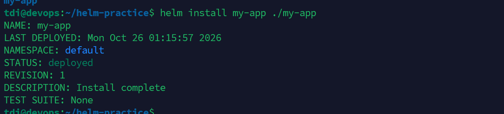
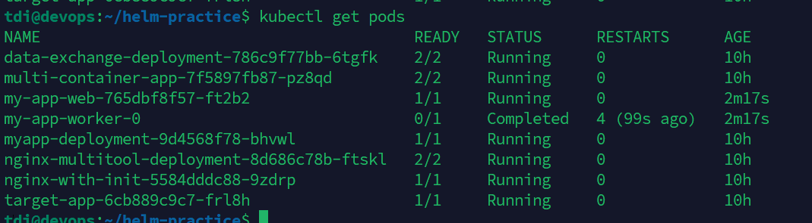
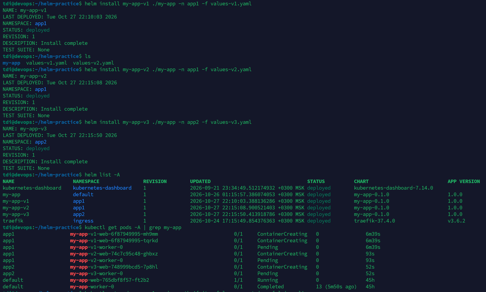

# Практика по Helm: Развертывание многокомпонентного приложения
В данном репозитории представлены решения двух практических задач по работе с пакетным менеджером Helm и оркестратором Kubernetes.

## Задача 1: Упаковка приложения в Helm-чарт
**Цель:** Создать Helm-чарт для многокомпонентного приложения, где каждый компонент разворачивается как отдельный `Deployment` или `StatefulSet`.

Приложение состоит из двух компонентов:
1. **Web-компонент**: Развертывается как `Deployment`.
2. **Worker-компонент**: Развертывается как `StatefulSet` (для демонстрации работы со stateful-нагрузками).

**Файлы манифестов:**
- [Шаблон Deployment](./my-app/templates/deployment-web.yaml)
- [Шаблон StatefulSet](./my-app/templates/statefulset-worker.yaml)
- [Значения по умолчанию (values)](./my-app/values.yaml)

**Вывод команды Helm:**

**Проверка статуса подов:**

## Задача 2: Запуск разных версий в разных Namespace
**Цель:** Продемонстрировать возможность запуска нескольких версий одного и того же приложения одновременно, используя изоляцию через Kubernetes Namespaces.

Было развернуто три разные версии приложения:
- **Версия 1 (v1)**: Развернута в namespace `app1` (2 реплики).
- **Версия 2 (v2)**: Развернута в том же namespace `app1` (1 реплика, другой тег образа).
- **Версия 3 (v3)**: Развернута в namespace `app2` (1 реплика, третий тег образа).

**Файлы манифестов:**
- [Настройки для v1](./values-v1.yaml)
- [Настройки для v2](./values-v2.yaml)
- [Настройки для v3](./values-v3.yaml)

**Список Helm-релизов во всех неймспейсах:**

## Окружение
- **ОС:** Ubuntu 20.04 (VirtualBox)
- **Kubernetes:** MicroK8s
- **Helm Version:** v4.3.1
- **Kubectl Version:** v1.35.6
